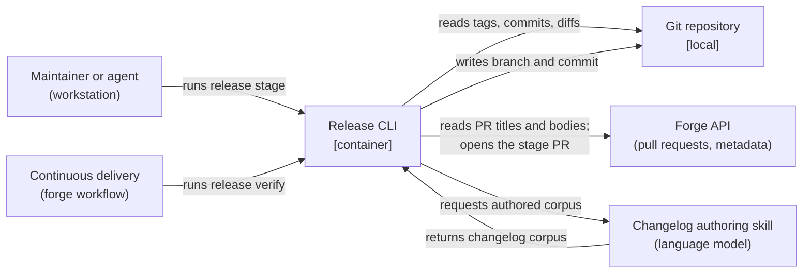

# Release CLI

## Overview

A single-binary command-line tool that turns "this branch is ready to
release" into a reviewable pull request. It reads tags and commits from
git, classifies release impact, computes the next version, assembles a
changelog corpus, renders it, and opens a stage pull request carrying one
commit ([[adr-002]]). It does not publish.

Its responsibility stops at the stage pull request deliberately. Artifact
construction and registry publication stay with each adopting repository,
which already owns its toolchains and its registry credentials. That keeps
the tool out of the business of knowing how to build a Go binary matrix or
a VSIX, and it keeps private-registry configuration where it already
works.

**Language models run outside this container.** Changelog authoring is
invoked by a person or an agent on a workstation, where a model is already
available, and the result is read back as a file. The tool never calls a
model itself. This is why the stage pull request matters: it is the review
surface for content a model wrote, and it exists before anything is
published.

- **Responsibility:** compute versions, assemble and render changelogs,
  stage releases, verify release commits.
- **Out of scope:** building artifacts, publishing to registries, calling
  language models, triggering releases from forge labels, and enforcing any
  relationship between branches and major versions.

## Container Context

The forge edge is optional at release time. WHERE squash commits carry
pull-request titles and descriptions, the tool reads them from git alone
and the release path needs no network access at all.

## Components

### Semver Core

[[component-semver-core]] — version parsing, comparison, and every name
derived from a version.

### Tag Reader

[[component-tag-reader]] — release tags reachable from a ref, as versions.

### Commit Collector

[[component-commit-collector]] — commits between two refs, with
pull-request identity and trailers parsed from them.

### Pull Request Metadata Collector

[[component-pr-metadata-collector]] — titles, descriptions and authorship
fetched from the forge for commits whose bodies do not carry them.

### Bump Classifier

[[component-bump-classifier]] — release impact computed deterministically
from commit metadata.

### Version Calculator

[[component-version-calculator]] — the next version, under this project's
version policy.

### Changelog Corpus Builder

[[component-changelog-corpus-builder]] — collected records assembled into
a changelog corpus.

### Changelog Authoring Bridge

[[component-changelog-authoring-bridge]] — the seam across which an
external author receives a corpus and returns an authored one.

### Changelog Renderer

[[component-changelog-renderer]] — a corpus rendered to markdown, one
rendering per target.

### Changelog Writer

[[component-changelog-writer]] — a rendered section placed into
`CHANGELOG.md`.

### Release Commit Verifier

[[component-release-commit-verifier]] — a candidate release commit checked
against the rules that make it publishable.

### Stage Orchestrator

[[component-stage-orchestrator]] — the sequence that produces a stage
branch and its pull request.

## Provided Contracts

- [[contract-changelog]] — the structured changelog corpus, written by any
  authoring producer and consumed by this container's renderers.

## Consumed Contracts

None. The forge API is a third-party interface governed by its vendor's
published contract.

## Data

The container owns no persistent store. It reads git history and the forge
API, and writes three things into the repository it operates on: a
`CHANGELOG.md` section, a release commit, and a stage branch. The
changelog corpus is a transient file exchanged with the authoring producer
and is not retained after a release is staged.

Git is the system of record for everything the tool computes. A version is
derived from reachable tags rather than stored, and a changelog is
derivable again from the same commit range, so the tool holds no state
that could drift from the repository.

## Infrastructure and Deployment

A single statically linked binary, distributed as a release artifact and
installable from source. It runs in two places and nowhere else: on a
maintainer's workstation for every command that writes, and in a forge
workflow for `release verify`, which only reads.

No daemon, no server, no scheduled component. The tool is invoked and
exits.

## Cross-Cutting Standards

This container SHALL comply with:

- [[release-tooling-standards]] — stage-branch and release-commit shape,
  verification, version computation, and the configuration surface.

The following govern the adopting project rather than this container, and it
SHALL NOT enforce them:

- [[repository-release-policy]] — branch roles, support window,
  propagation, readiness.
- [[cli-distribution-policy]] — publication, resolution, provenance,
  channels, withdrawal.

## Change Guidance

WHEN a version-policy rule changes, [[component-version-calculator]] and
the acceptance criteria in [[frd-version-computation]] SHALL be updated in
the same change.

---

WHEN the changelog schema changes, `schemas/changelog.strata`,
[[contract-changelog]] and every generated binding SHALL be updated in the
same change.

---

The components in this container SHALL NOT call a language model.

**Rationale:** Authoring happens outside the container, on a workstation
where a model is already available, so that adopters need no API
credential and no per-call budget. A component that reached for a model
would reintroduce both.

---

A component that computes a version, classifies impact, or renders a
corpus SHALL be a pure function of its inputs.

**Rationale:** These are the parts whose correctness matters most and
whose failures are hardest to see. Purity is what makes them exhaustively
testable without fixtures or network.

---

WHEN a component reads from the forge API, it SHALL degrade to git-only
behaviour rather than failing.

**Rationale:** The release path must work offline and in repositories
hosted on a forge the tool does not integrate with.

---

- **Verification gates:** the unit suites of every component changed, plus
  the end-to-end staging test against a fixture repository.

## Key Decisions

- [[adr-001]] — the tooling is branch-agnostic; which branches carry which
  majors is the adopting project's policy.
- [[adr-002]] — a release is triggered by merging a single-commit stage
  branch, and delivery verifies that commit independently.
- [[adr-003]] — the bump is computed deterministically; authored prose
  proposes but never decides.
- [[adr-004]] — no existing release tool is adopted.
- [[adr-005]] — the tooling is a composable library behind a thin command
  surface, with publication left to adopting repositories.

## Open Questions

- [ ] How an autorelease policy can work without a language model in
  continuous delivery. Forge labels were rejected as the trigger because
  the autorelease path would need a model in a workflow, and therefore an
  API credential and a per-call budget. Until this is answered, staging is
  a workstation command and autorelease is out of scope. Decided by the
  project owner.

## References

- `shared/c4-standards.md` — C4 mapping rules and diagram conventions
- [[frd-version-computation]], [[frd-changelog-authoring]],
  [[frd-changelog-rendering]], [[frd-release-staging]],
  [[frd-tool-configuration]] — the features this container realizes
- [[frd-release-withdrawal]] — a capability deferred beyond this milestone
