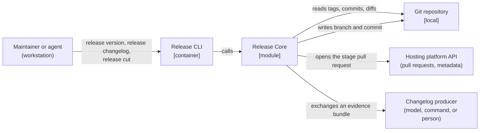

# Release CLI

## Overview

A single-binary command-line tool that exposes the release process to a
maintainer. It parses arguments, loads the repository's release
configuration, calls [[module-release-core]], and renders the result.

It holds no release logic. Version computation, evidence collection,
changelog authoring, bump suggestion, rendering and staging all live in the
module, so that a
second front end — an HTTP service, a tool-calling server — is a new wrapper
rather than a second implementation of the same rules.

- **Responsibility:** the command surface, configuration loading, output,
  exit codes, and prompting a person to confirm the suggested bump.
- **Out of scope:** everything the module owns, plus building artifacts,
  publishing them, and verifying a merged release commit — the last of which
  is the adopting project's required checks ([[repository-release-policy]]).

## Container Context



Neither continuous integration nor continuous delivery needs to invoke this
container: verifying a merged release commit is done by the project's
required checks, and publishing is done by the project's own workflows.
`release version` and `release config` need no producer and no network, so a
workflow may still run them.

## Components

### Release Core

[[module-release-core]] — the library this container wraps; every release
capability lives there.

### Command Surface

Subcommands, flags and argument validation. `release version` prints the
computed version and its justification; `release changelog` collects
evidence, authors the structured changelog, suggests a bump and renders
without staging;
`release cut [major|minor|patch]` stages a release, with `--skip-notes` to
stage with the mechanical producer in place of an authoring exchange.

`release version [major|minor|patch] [--target <branch>] [--json]` calls the
release core's version resolution operation with the loaded configuration's
policy: its `tag_prefix`, `stage_prefix`, `leaps`, `pre1_remap` and
`signals`. Without `--target` it resolves the configured `target`, and
without one the ref `origin/HEAD` points to, read locally
(`refs/remotes/origin/<branch>`); IF neither is available, THEN it exits 2
naming `git remote set-head origin --auto`. Its answer is one mapping with
keys `base`, `impact`, `named`, `determined_by` (each `hash`, `subject`,
`signal`), `unclassified` (each `hash` and `subject`) and `next`, in that
order, where `impact` is the named bump or else the signal floor: the
highest impact the commits' `Release-Type:` trailers, conventional types and
breaking markers indicate. It invokes no producer. It exits 1 after printing
the answer WHEN no release is warranted or the policy refuses the version; 1
without an answer WHEN a named bump is below the signal floor; and 2 for an
invalid bump or a repository it cannot read. WHEN a bump is named and the
signal floor is none, it prints a warning on standard error and still exits
0.

`release changelog [major|minor|patch] [--target <branch>] [--skip-notes]
[--redo-notes] [--corpus <path>] [--force] [--write] [--json]` calls the
release core's changelog operation (`internal/changelog`), which resolves the
base version and the signal floor as `release version` does, builds the
evidence bundle from every commit in the range as git records it (with its
pull request where git carries one, its changed files, and its diff within
`changelog.diff_budget.release`), exchanges it with the configured producer
through the authoring bridge (for `claude`, the `release:changelog` skill),
has the Bump Suggester ([[component-bump-suggester]]) derive the suggested
bump from the authored entries' kinds, raised to the signal floor, sets the
corpus `version` from the named bump or else the suggestion, and renders it.
It never prompts and confirms nothing: without a named bump the section is a
preview under the suggestion. Its answer is one mapping with keys `version`,
`bump`, `named`, `suggested`, `floor`, `reasons` (the entries that drove the
suggestion), `raised_by_floor`, `unclassified`, `corpus_path` (where the
authored corpus is kept, relative to the repository root when inside it;
null under `--skip-notes`) and `section` (the rendered changelog section,
trimmed as every multi-line value is), in that order. A named bump below the
signal floor is refused (exit 1) unless `--force` is given; one below the
suggestion proceeds with a warning on standard error. It exits 1 WHEN no
release is warranted, the policy refuses the version, `--force` is given
without a bump, or the producer fails or its corpus is rejected. WHEN the
configured producer is unavailable or fails, it reports the failure and
stops, naming `--skip-notes`; it never falls back to another producer on
its own. `--skip-notes` authors with the mechanical producer and reads no cache, so
the suggestion is the signal floor; `--redo-notes` discards the cached
corpus and authors again; `--corpus <path>` reads that path instead of the
cache WHEN it exists and writes the authored corpus there otherwise;
`--write` places the section in `CHANGELOG.md` through the changelog writer
and changes nothing else, and requires a named bump, because this command
confirms no suggestion. `--skip-notes` with `--redo-notes` or `--corpus`,
`--write` without a bump, and a missing producer prerequisite exit 2. The
repository web URL the renderer links sources to is derived from a GitHub
`origin` remote, and sources render as plain text otherwise.

`release cut [major|minor|patch] [--target <branch>] [--skip-notes]
[--force] [--redo-notes] [--no-pull-request] [--dry-run] [--yes] [--json]`
passes its flags to the release core's Stage Orchestrator (`internal/cut`).
Without `--target` it cuts the configured `target`, or else the branch
`origin/HEAD` points to, as a branch name on `origin`.

The release core never prompts: when no bump is named it returns the
suggested bump and its reasons as a halt, and the confirmation this
container obtains is the input to the next call, as an acceptance or a
named bump. That call reads the authored changelog from the cache, so the
suggestion confirmed is the one shown.

- A named bump needs no confirmation. Below the signal floor it is refused
  unless `--force` is given; below the suggestion it proceeds with a
  warning on standard error naming the entries that drove the suggestion.
- WHEN no bump is named and `--yes` is given, the suggestion is confirmed.
- WHEN no bump is named, standard input is a terminal and `--yes` is not
  given, it shows on standard error the suggested bump, the entries that
  drove it, whether the signal floor raised it, and the commits with no
  signal, and prompts for the bump, offering the suggestion: an empty
  answer or `y` accepts it, `major`, `minor` or `patch` names a bump, and
  anything else declines, which is a refusal.
- Otherwise it halts: it writes nothing, answers `suggested`, `floor`,
  `reasons`, `raised_by_floor`, `unclassified` and `corpus_path`, names
  `release cut --yes` and `release cut <bump>` on standard error, and exits
  1.
- WHEN no bump is named, the suggestion is none and the changelog holds
  entries with no kind (commits the mechanical producer could not
  classify), it halts the same way even under `--yes`, naming
  `release cut <bump>`; a named bump answers it without `--force`.

WHILE standard input is a terminal and neither `--yes` nor `--dry-run` is
given, it shows the version and the writes it will make on standard error and
prompts once before the first write; anything but `y` or `yes` declines,
which is a refusal. The release commit records the confirmed bump as a
`Release-Type:` trailer, and the stage pull request shows the changelog
section, the suggested bump and its reasons. Its answer is one mapping with
keys `version`, `branch`, `commit`, `pull_request` (the URL, or null) and
`writes` (every write made, in order, each a line such as
`push cut/1.9.0 to origin`); under `--dry-run` it is `version`, `branch`,
`writes` listing the writes it would make, and `section`, the changelog
section the release commit would write into `CHANGELOG.md`. It exits 1 on a
refusal (nothing to release, a halt for an unconfirmed bump, a named bump
below the signal floor without `--force`, an existing stage branch, an
unconfigured `commands.propagate`, a `gh` that is missing or not
authenticated when a pull request is to be opened, a failing configured
command, a path outside `release_paths`, a declined prompt, a failing or
rejected producer), having written nothing and answering nothing except for
the halt; 3 WHEN a write failed after another succeeded, answering with
every write made and naming on standard error the commands that finish or
discard the release; and 0 otherwise. `--force` without a bump is a
refusal. A named bump over a range with nothing releasable — a suggestion
of none, the signal floor included, and no entry without a kind — is a
refusal suggesting `--force`, which stages it anyway. `--force` has two
jobs on `cut`: it stages a named bump over a range with nothing
releasable, and it accepts a named bump below the signal floor. `--skip-notes` with `--redo-notes`, or a bump other
than `major`, `minor` or `patch`, is invalid (exit 2).

`release config [--json]` answers with the effective configuration, declared
values over the release core's defaults, as one mapping: `target`,
`tag_prefix`, `stage_prefix`, `release_branches`, `release_paths`, `leaps`,
`pre1_remap`, `signals`, `commands` holding `validate`, `propagate` and
`preflight`, `changelog` holding `groups`, `other_heading`,
`breaking_heading`, `producer`, `producer_command`, `diff_budget` (holding
`release`) and `diff_exclude`, and `adapters` holding
`pull_requests` and `diffs`, in that order. An unset command is null and an
empty list `[]`.
`target` is the configured one, or else the branch `origin/HEAD` points to;
IF neither is available, THEN it exits 2 naming
`git remote set-head origin --auto`.

The global flags `-C, --repo <path>` and `--config <path>` name the
repository and the configuration file for every command.

```component
title: Command Surface
slug: component-command-surface
description: Subcommand and flag definitions, argument validation, and the mapping from invocation to a core library call.
```

### Configuration Loader

Discovers the repository's release configuration, parses it, and refuses a
configuration the tooling cannot accept before any command runs.

- It runs as the root command's persistent pre-run, so it precedes every
  subcommand's own work; the root itself, `help` and `--help` load nothing.
- The repository root is the working tree containing `-C/--repo`, or the
  working directory; outside a working tree it is that directory.
- WHEN `--config` is given, it reads that file, and refuses one that does
  not exist. Otherwise it looks for `release.toml` and
  `config/release.toml` at the repository root: both present is refused,
  naming both; neither present means the release core's defaults.
- It decodes TOML over the release core's defaults, so a declared value,
  lists included, replaces its default. A key the configuration does not
  define is refused by name, which is also why no file can disable a check.
- It then applies the release core's validation, and reports every reason
  — unknown keys and validation refusals together — on standard error, and
  the CLI exits 2 with nothing else run.

```component
title: Configuration Loader
slug: component-configuration-loader
description: Locates and parses the repository's release configuration, and validates it before any command executes.
```

### Output Renderer

YAML by default and JSON under `--json`, plus exit codes. The module returns
structured results; this renders them as [[cli-output-standards]] specifies,
so one answer reads the same at a terminal, in a script and to an agent.

```component
title: Output Renderer
slug: component-output-renderer
description: Renders structured results from the core library as YAML by default or JSON on request, and sets exit codes.
```

## Provided Contracts

- [[contract-release-cli]] — the command surface: commands, arguments, flags,
  output and exit codes.

The changelog corpus contract is provided by [[module-release-core]] rather
than here.

## Consumed Contracts

None. The hosting platform's API is a third-party interface governed by its
vendor's published contract.

## Data

The container owns no persistent store and holds no state between
invocations. It reads a configuration file and writes nothing of its own.

## Infrastructure and Deployment

A single statically linked binary, distributed as a release artifact and
installable from source. It is invoked on a maintainer's workstation and
exits.

No daemon, no server, no scheduled component. Commands that author require a
workstation, or an agent session, because the authoring exchange needs a
changelog producer that continuous delivery does not have.

## Cross-Cutting Standards

This container SHALL comply with:

- [[release-tooling-standards]] — the configuration surface in particular.

## Change Guidance

The container SHALL NOT implement a release capability that belongs to
[[module-release-core]].

**Rationale:** Logic that migrates into the front end stops being reachable by
any other front end, which is the whole reason the module exists.

---

WHEN a command is added, it SHALL map onto capabilities the module already
exposes, or the module SHALL be extended in the same change.

---

The container SHALL NOT make a release decision the module could make.

**Rationale:** A default applied in argument parsing is a default no other
consumer inherits.

---

- **Verification gates:** the command-surface tests, including argument
  validation and exit codes, plus the configuration-loader tests.

## Key Decisions

- [[adr-005]] — the release process is a composable library behind a thin
  front end; this container is that front end.

## Open Questions

- [ ] How an autorelease policy can work without a language model in
  continuous delivery. Hosting-platform labels were rejected as the trigger
  because the autorelease path would need a model in a workflow, and
  therefore an API credential and a per-call budget. Until this is answered,
  staging is a workstation command and autorelease is out of scope. Decided
  by the project owner.

## References

- `shared/c4-standards.md` — C4 mapping rules and diagram conventions
- [[module-release-core]] — the library this container wraps
- [[contract-release-cli]] — the command surface this container vends
- [[cli-output-standards]] — the shape the Output Renderer gives every answer
- [[frd-tool-configuration]] — the configuration this container loads
- [[component-bump-suggester]] — the suggested bump `release cut` asks a
  person to confirm
