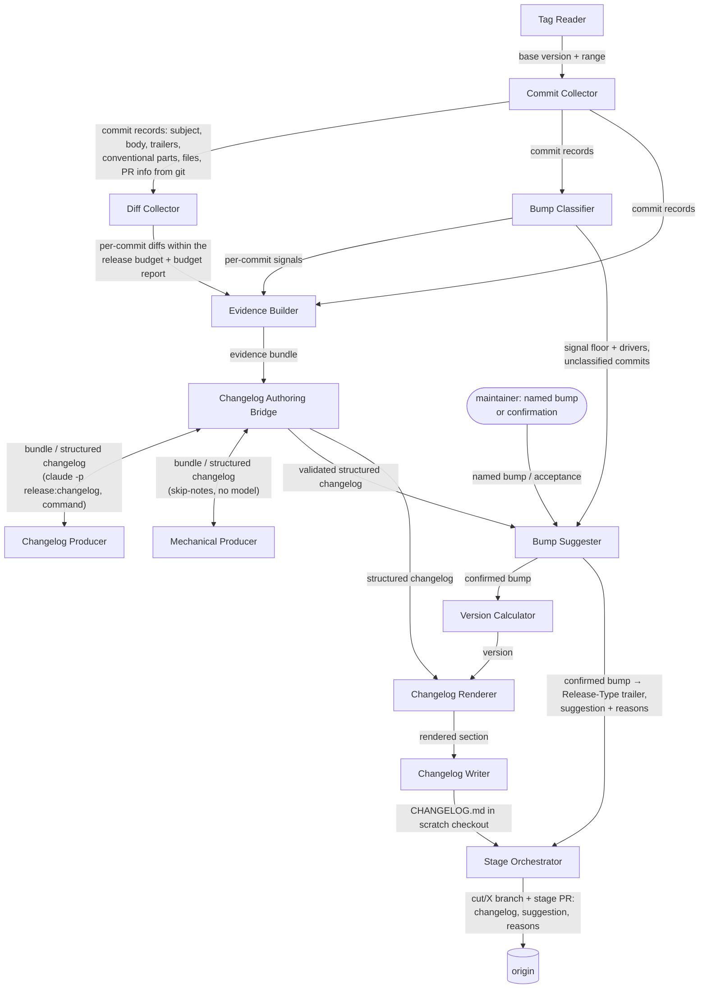

# Release Core

## Overview

Every capability of the release process lives here: reading tags and commits,
collecting diffs, building the evidence a producer authors from, computing
the signal floor, suggesting a bump and taking a person's confirmation of
it, computing versions, rendering changelogs, and staging
a release as a branch and a pull request. The command-line tool is a wrapper
around this module and holds no release logic of its own.

The separation exists so the release process is reachable by more than one
front end. A command surface is the first consumer; an HTTP service or a
tool-calling server is a plausible second, and neither should have to
reimplement version computation or re-derive what a release commit may
contain. Keeping the logic here means a second front end is a new wrapper
rather than a new implementation.

A module rather than a set of components because it crosses a boundary of
independent change: it is composed into a container that does not own it, and
it has internal structure worth documenting. It is `internal` for now —
unpublished, evolving in lockstep with its consumers — and becomes `public`
the first time something outside this repository depends on it.

- **Responsibility:** the whole release process as a library.
- **Out of scope:** argument parsing, terminal output, prompting, exit codes,
  and process lifetime, which belong to a front end; building artifacts and
  publishing them, which belong to adopting repositories; calling a language
  model, which happens outside the process entirely.
- **Source & tests:** `internal/`.

## Flows

The module reads the code once, when a release is cut. Everything it needs
is in git: the commits since the base release tag, the pull request title
and description a squash or merge commit carries, the changed files and the
diffs. A model authors a structured changelog from that evidence, the bump
is suggested from the changelog and floored by the explicit signals in git,
and a person confirms it before anything is written ([[adr-003]]).

### Release time

The `Prepare` operation runs this flow up to the renderer; the Stage
Orchestrator composes it with the writes.

1. [[component-tag-reader]] finds the latest release tag reachable from the
   pinned target, which is the base version and the start of the range.
2. [[component-commit-collector]] reads every commit in the range from git:
   hash, subject, body, trailers, author and date, the conventional type,
   scope and breaking marker where the subject has them, the changed files,
   and the pull request number, title and description where a squash or
   merge commit carries them. No hosting platform is called.
   [[component-pr-metadata-collector]] is an optional, non-MVP enrichment
   for a commit whose body lacks the description.
3. [[component-diff-collector]] reads each commit's diff within the release
   budget, leaving out excluded paths, and reports what it truncated or
   omitted.
4. [[component-bump-classifier]] computes the *signal floor* from the
   explicit records in git — `Release-Type:` trailers, conventional types
   and breaking markers — and reports the commits that carry none, the
   unclassified commits. It needs no model. `release version` uses only
   this step, with a named bump where one is given.
5. [[component-evidence-builder]] joins the records, diffs and signals into
   the evidence bundle: one `CommitEvidence` per commit, carrying its
   record with the pull request information git holds, its files, its diff
   and the signal the classifier read.
6. [[component-changelog-authoring-bridge]] exchanges the bundle with the
   configured [[component-changelog-producer]] (`release:changelog` for
   `claude`), or with [[component-mechanical-producer]] when notes are
   skipped (`--skip-notes`), and validates the **structured
   changelog** it returns: entries are changes, not commits; each has a
   kind, a scope, a summary, migration text where it is breaking, and the
   commits it is derived from; and every commit is cited by an entry or
   listed as omitted with a reason. WHEN the configured producer is
   unavailable or fails, the bridge reports the failure and the command
   stops, naming `--skip-notes`; it does not fall back on its own.
7. [[component-bump-suggester]] derives the **suggested bump** from the
   entry kinds (any breaking entry major, else any feature minor, else any
   fix, performance change, refactoring or revert patch, else none), raises it to
   the signal floor where the floor is higher, and gives its reasons. Given
   a named bump, it refuses one below the floor unless forced, and warns on
   one below the suggestion. With no named bump it halts until the
   suggestion is accepted. A range is releasable WHEN the suggestion is
   patch or above, or an entry has no kind; WHEN the suggestion is none
   and an entry has no kind, it halts for a named bump, which needs no
   force; WHEN the suggestion is none and every entry has a kind, nothing
   is releasable and a named bump proceeds only forced. A front end prompts, or accepts with `--yes`, or
   stops and reports the halt, and calls again with the answer.
8. [[component-version-calculator]] computes the version from the confirmed
   bump; [[component-changelog-renderer]] renders the structured changelog
   for it under the configured headings; [[component-changelog-writer]]
   places the section in the changelog file.
9. [[component-stage-orchestrator]] commits the section with the confirmed
   bump as a `Release-Type:` trailer, so the version is recomputable from
   git without re-running a model, and opens the stage pull request showing
   the changelog, the suggested bump and its reasons. Reviewing it is where a
   person reviews the model's changelog before anything is published.

Without a model, the mechanical producer writes entries from conventional
subjects and lists unclassified commits under the other heading, the
suggestion is the signal floor alone, and a range whose floor is none and
which holds an entry with no kind halts for a named bump.

### Extension: pull request release notes (deferred)

A later `release notes` command may author a reviewed `## Release notes`
block per pull request from its diff, and the squash merge would carry it
into git. The Evidence Builder would then attach a parsed block to its
commit's evidence, and the Bump Classifier could read its impact as a
reviewed signal. The core flow works without it, and nothing in the core
requires it.

## Interface

- **Surface:** one operation per release capability — resolve a base version,
  compute the signal floor, suggest and confirm a bump, compute a next
  version, collect records and diffs, build evidence, prepare a changelog,
  render it, write it, stage a release. Each is callable independently; the
  staging operation composes the rest.
- **Guarantees:**
  - The module SHALL expose every capability independently of the staging
    operation, so a consumer may use one without invoking the others.
  - The module SHALL return structured results rather than writing to a
    terminal.
  - The module SHALL NOT read process arguments or environment for anything
    a caller can pass.
  - The module SHALL NOT prompt. A confirmation the release needs is a
    result naming what to confirm, and the confirmation is an input to the
    next call.
  - The module SHALL NOT terminate the process.
  - The module SHALL NOT call a language model. A model-backed producer runs
    as a separate process that the authoring bridge starts and exchanges
    JSON with.
- **Version resolution:** `internal/resolve`. `Resolve` takes a repository
  path, a target ref, an optional named bump, an optional graduation flag
  and a policy, and returns the base version (or its absence) with its tag,
  the impact, whether it was named, the signal floor whatever was named
  (none meaning nothing releasable on the signals alone), the commits that
  determined the floor with the signal each indicated, the unclassified
  commits, and the next version, a no-release result or a policy violation.
  It reads only the explicit signals in git and invokes no producer. It
  composes [[component-tag-reader]], [[component-commit-collector]],
  [[component-bump-classifier]] and [[component-version-calculator]],
  maps the classifier's bump onto the calculator's own impact, and never
  writes to the repository. A repository that cannot be read is an error; a
  refused or unwarranted release is a result.
- **Changelog operation:** `internal/changelog`. `Prepare` takes the
  repository, a target ref, an optional named bump, whether the release is
  forced, whether the suggestion is accepted, the loaded configuration, the
  producers by name, an optional changelog path, and the redo and skip
  requests. It pins the target to its commit hash, so the commits read, the
  range recorded and the cache key describe one head, then resolves the base
  version and the signal floor, collects every commit's diff within
  `changelog.diff_budget.release`, builds the evidence bundle
  ([[component-evidence-builder]]), exchanges it
  ([[component-changelog-authoring-bridge]]), suggests and decides the
  bump ([[component-bump-suggester]]), computes the version from the
  confirmed bump, sets the changelog `version`, and renders it
  ([[component-changelog-renderer]]). An unwarranted release, a refused
  named bump, and a halt for confirmation carrying the suggestion and its
  reasons are results; it writes only the authoring cache, never the
  changelog file.
- **Bump suggestion:** `internal/suggest`. `Suggest` takes the structured
  changelog's entries and omissions, the signal floor with its drivers, the unclassified commits, an optional
  named bump, and whether the release is forced and the suggestion
  accepted, and returns the confirmed bump with who decided it and the
  suggestion with its reasons, a halt with them, a refusal of a named
  bump below the floor, or a range that is not releasable
  ([[component-bump-suggester]]). It is pure.
- **Default policy:** `DefaultPolicy` — tag prefix `v`, stage prefix
  `cut/`, `leaps` off, `pre1_remap` on, and every commit signal enabled:
  `release-type`, `conventional-type` and `breaking-marker`. The
  configuration model extends it.
- **Configuration model:** `internal/config`. `Config` holds every
  repository-specific setting, and `Default` gives each its default:
  `target` (the repository's default branch), `tag_prefix` `v`,
  `stage_prefix` `cut/`, `release_branches` (globs, empty),
  `release_paths` (empty), `leaps` off, `pre1_remap` on, `signals` (every
  signal), `commands.validate` and `commands.propagate` (unset) and
  `commands.preflight` (empty), and the `changelog` and `adapters`
  settings below. Its version settings are `DefaultPolicy`'s, and `Policy`
  turns a configuration into the resolution policy.
  - `changelog.groups` is an ordered list of `{kind, heading}`, `kind` a
    `ChangeKind` name; the default is `FEATURE` "Features", `FIX` "Fixes",
    `PERFORMANCE` "Performance", `REVERT` "Reverts". A declared list
    replaces the default whole, so a kind it omits does not render.
    `changelog.other_heading` defaults to "Other changes" and
    `changelog.breaking_heading` to "Breaking changes". Headings are any
    UTF-8 text, emoji included, rendered verbatim.
  - `changelog.producer` names the changelog producer the authoring bridge
    invokes: `claude` (the default), `command` or `mechanical`;
    `changelog.producer_command` is the command the `command` producer
    runs, unset by default.
  - `changelog.diff_budget.release` bounds the patch text in one evidence
    bundle, in bytes; the default is 204800.
  - `changelog.diff_exclude` lists the paths whose patches no evidence
    bundle carries, matched as `release_paths` entries are, with `**`
    matching any number of path segments. The default is `**/go.sum`,
    `**/package-lock.json`, `**/yarn.lock`, `**/pnpm-lock.yaml`,
    `**/Cargo.lock`, `**/poetry.lock`, `vendor/` and
    `testdata/**/expected/`. A declared list replaces the default whole.
    An excluded path still appears in its commit's file list.
  - `adapters.diffs` turns the Diff Collector on and defaults to `true`.
    `adapters.pull_requests` turns on the Pull Request Metadata Collector,
    an optional enrichment for commits whose body lacks the pull request
    description, and defaults to `false`. The commit adapter is always on
    and has no setting.
  - `Validate` SHALL refuse an empty `stage_prefix`, a `signals` entry
    naming no known signal, a `changelog.groups` kind that is not a
    `ChangeKind` name or is listed twice, a malformed `release_branches`
    or `changelog.diff_exclude` glob, a `changelog.diff_budget` value that
    is not a positive integer, a `changelog.producer` naming no producer,
    the `command` producer with no `changelog.producer_command`,
    `adapters.pull_requests = true` (until the pull request adapter lands),
    and a `release_branches` glob that can match any stage branch name:
    any name made of `stage_prefix` followed by one or more version
    characters (`0-9`, `a-z`, `A-Z`, `.`, `-`, `+`), whatever the version
    ([[release-tooling-standards]]; Go `path.Match`, where `*` does not
    cross `/`). The check is exact over that set, so it may refuse a glob
    matching only a non-version name under the prefix, such as
    `cut/latest`, but never misses a stage branch. It SHALL return every
    reason found, not only the first.
  - The model SHALL derive no constraint from the name in `target`, and
    SHALL have no setting that disables a check the tooling performs.
  - `TargetRef` SHALL answer the configured `target` when one is declared,
    and otherwise the branch `origin/HEAD` points to, read locally; IF
    `origin/HEAD` is unset, THEN it SHALL return `ErrNoDefaultBranch`, which
    names `git remote set-head origin --auto`, and a front end exits 2.
  - The model reads no file: finding and decoding one is the front end's
    Configuration Loader.

**Rationale for the first two:** a front end that has to parse the library's
human-readable output is a front end that breaks when the wording changes, and
a library that prints cannot serve a service.

## Components

### Semver Core

[[component-semver-core]] — version parsing, comparison, and every name
derived from a version.

### Tag Reader

[[component-tag-reader]] — release tags reachable from a ref, as versions.

### Commit Collector

[[component-commit-collector]] — commits between two refs, with pull-request
identity, trailers and the changed-file list parsed from them.

### Diff Collector

[[component-diff-collector]] — per-commit code diffs within a byte budget,
excluding configured paths and reporting what it truncated.

### Pull Request Metadata Collector

[[component-pr-metadata-collector]] — pull-request metadata fetched from the
hosting platform. **Not part of the MVP:** an optional enrichment for
commits whose body lacks the pull request description, when the platform is
reachable. Never a version signal.

### Evidence Builder

[[component-evidence-builder]] — the evidence bundle a producer authors
from: per commit, its record with the pull request information git carries,
its files, its diff and its signal.

### Bump Classifier

[[component-bump-classifier]] — the signal floor computed deterministically
from explicit signals in git, with the commits that carry none.

### Bump Suggester

[[component-bump-suggester]] — the suggested bump from the structured
changelog's entry kinds, raised to the signal floor, with its reasons; and
the confirmed bump from an acceptance or a named bump, or a halt.

### Version Calculator

[[component-version-calculator]] — the next version, under the project's
version policy.

### Changelog Authoring Bridge

[[component-changelog-authoring-bridge]] — the seam across which a producer
receives an evidence bundle and returns a structured changelog, validated
so that every commit is cited or omitted with a reason.

### Changelog Producer

[[component-changelog-producer]] — the component type that authors a
structured changelog from evidence: a language model, a command, the
mechanical producer, or a person.

### Mechanical Producer

[[component-mechanical-producer]] — the producer of last resort: entries
from conventional subjects, unclassified commits under the other heading,
with no model.

### Changelog Renderer

[[component-changelog-renderer]] — a structured changelog rendered to
markdown, one rendering per target.

### Changelog Writer

[[component-changelog-writer]] — a rendered section placed into the changelog
file.

### Stage Orchestrator

[[component-stage-orchestrator]] — the sequence that cuts a release, producing
a stage branch and its pull request.

### Delegated Command Runner

[[component-delegated-command-runner]] — a repository's configured command
run for a named release step, with its outcome reported.

## Pattern Guidance

Not applicable — this module is a single instance, not a pattern.

## Versioning and Compatibility

WHILE this module is `internal`, it MAY be refactored or broken in the same
change as its consumers, and no deprecation window applies.

---

WHEN this module becomes `public`, its interface SHALL be versioned under
semantic versioning and this section SHALL be rewritten to state its
compatibility obligations.

---

The module SHALL version the structured changelog and the evidence bundle
it exchanges independently of itself, under [[contract-changelog]].

**Rationale:** The changelog is written by producers outside this
repository, and edited by people when a release needs correcting by hand, so
its compatibility is a contract concern rather than a library-versioning
one.

## Cross-Cutting Standards

This module SHALL comply with:

- [[release-tooling-standards]] — stage-branch and release-commit shape,
  version computation, the signal floor, the suggested bump and its
  confirmation, and the configuration surface.

The following govern the adopting project rather than this module, and it
SHALL NOT enforce them:

- [[repository-release-policy]] — branch roles, support window, propagation,
  readiness, squash-merge settings, and the verification of a release
  commit.
- [[cli-distribution-policy]] — publication, resolution, provenance,
  channels, withdrawal.

## Change Guidance

WHEN a version-policy rule changes, [[component-version-calculator]] and the
acceptance criteria in [[frd-version-computation]] SHALL be updated in the
same change.

---

WHEN the changelog schema or the evidence schema changes,
`schemas/changelog.strata`, `schemas/evidence.strata`, [[contract-changelog]]
and every generated binding SHALL be updated in the same change.

---

WHEN a collector's record shape changes, `schemas/collection.strata` SHALL be
updated in the same change.

---

A component that computes a version, computes the signal floor, suggests or
decides a bump, builds evidence, or renders a changelog SHALL be a pure
function of its inputs.

**Rationale:** These are the parts whose correctness matters most and whose
failures are hardest to see. Purity is what makes them exhaustively testable
without fixtures or network.

---

A component in this module SHALL NOT call a language model.

**Rationale:** Authoring happens outside the process, where a model is already
available, so that adopters need no API credential and no per-call budget. A
component that reached for a model would reintroduce both.

---

WHEN a component reads from the hosting platform, it SHALL degrade to
git-only behaviour rather than failing.

**Rationale:** The release path must work offline and in repositories hosted
on a platform the tooling does not integrate with.

---

- **Verification gates:** the unit suites of every component changed, plus the
  end-to-end staging test against a fixture repository.

## Key Decisions

- [[adr-001]] — the tooling is branch-agnostic; which branches carry which
  majors is the adopting project's policy.
- [[adr-002]] — a release is staged as a branch carrying the release commit
  and merged by pull request.
- [[adr-003]] — AI-authored changelog with a suggested, confirmed bump: a
  model authors a structured changelog from commit evidence in git, the
  bump is suggested from its entry kinds and floored by explicit git
  signals, and a person confirms it, which is committed as a
  `Release-Type:` trailer.
- [[adr-004]] — the adopting repositories do not use conventional commits
  consistently, so no per-commit signal is required.
- [[adr-005]] — the release process is a composable library behind a thin
  front end, which is what this module is.
- [[adr-006]] — git is reached through the installed git binary.

## Open Questions

None. No second consumer is near-term, so the interface may keep changing
freely while this module is `internal`. The separation from the command
surface is kept because it costs nothing now and would be expensive to
introduce later, not because a second front end is planned.

## References

- `shared/c4-standards.md` — C4 mapping rules and diagram conventions
- [[container-release-cli]] — the container composing this module
- [[contract-changelog]] — the structured changelog and evidence bundle
  this module exchanges
- [[frd-version-computation]], [[frd-changelog-authoring]],
  [[frd-changelog-rendering]], [[frd-release-staging]],
  [[frd-tool-configuration]] — the features this module realizes
