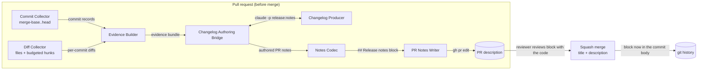
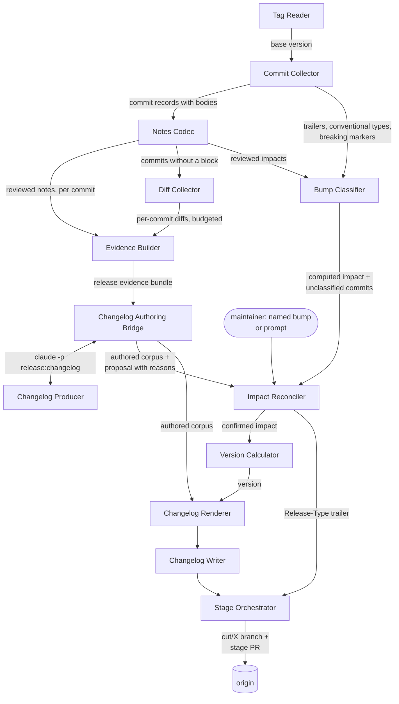

# Release Core

## Overview

Every capability of the release process lives here: reading tags and commits,
collecting diffs, building the evidence a producer authors from, classifying
and reconciling impact, computing versions, rendering changelogs, and staging
a release as a branch and a pull request. The command-line tool is a wrapper
around this module and holds no release logic of its own.

The separation exists so the release process is reachable by more than one
front end. A command surface is the first consumer; an HTTP service or a
tool-calling server is a plausible second, and neither should have to
reimplement version computation or re-derive what a release commit may
contain. Keeping the logic here means a second front end is a new wrapper
rather than a new implementation.

A module rather than a set of components because it crosses a boundary of
independent change: it is composed into a container that does not own it, and
it has internal structure worth documenting. It is `internal` for now —
unpublished, evolving in lockstep with its consumers — and becomes `public`
the first time something outside this repository depends on it.

- **Responsibility:** the whole release process as a library.
- **Out of scope:** argument parsing, terminal output, prompting, exit codes,
  and process lifetime, which belong to a front end; building artifacts and
  publishing them, which belong to adopting repositories; calling a language
  model, which happens outside the process entirely.
- **Source & tests:** `internal/`.

## Flows

The module reads the code twice: once when a pull request is opened, so its
release notes are reviewed with the code, and once when a release is cut, so
the changelog is composed from those reviewed notes and from the diffs of
any commit that has none ([[adr-003]]).

### Pull request time

The `Notes` operation runs this flow.

1. [[component-commit-collector]] reads the commits between the merge base
   of the pull request's base branch and its head, each with its body,
   trailers and changed-file list.
2. [[component-diff-collector]] reads each commit's diff, leaving out the
   excluded paths and keeping within the pull-request budget, and reports
   anything it truncated or omitted.
3. [[component-evidence-builder]] joins the records and diffs into an
   evidence bundle with purpose `PULL_REQUEST`.
4. [[component-changelog-authoring-bridge]] hands the bundle to the
   configured [[component-changelog-producer]], which for `claude` runs the
   `release:notes` skill, and validates the `PullRequestNotes` it returns:
   one entry per user-visible change and a proposed impact for the pull
   request.
5. [[component-notes-codec]] renders the notes as a `## Release notes` block,
   pinned to the head commit it was authored from.
6. [[component-pr-notes-writer]] replaces the block in the pull request
   description, or the front end prints the block for an agent to paste.
7. The reviewer reviews the block with the code. The squash merge, using the
   pull request title and description ([[repository-release-policy]]),
   carries the reviewed block into the commit body, where release time reads
   it.

`release notes --check` runs none of these steps. The PR Notes Writer reads
the description, the Notes Codec parses its block, and the block is stale
WHEN the pull request's diff has changed since the head its marker records.
No producer runs, so the check needs no model and fits a required check in
CI.

### Release time

The `Prepare` operation runs this flow up to the renderer; the Stage
Orchestrator composes it with the writes.

1. [[component-tag-reader]] finds the latest release tag reachable from the
   pinned target, which is the base version and the start of the range.
2. [[component-commit-collector]] reads every commit in the range, with its
   body, trailers and changed-file list.
3. [[component-notes-codec]] parses each commit body's `## Release notes`
   block. A commit with a block yields its reviewed notes and their impact;
   a commit without one, or with one that does not parse, is passed on for
   its diff.
4. [[component-diff-collector]] reads the diff of each commit without a
   block, within the release budget. Commits with a block need no diff: the
   reviewed notes already describe them.
5. [[component-bump-classifier]] computes the impact from the reviewed
   signals — notes-block impacts, `Release-Type:` trailers, conventional
   types and breaking markers — and reports the commits that carry none.
6. [[component-evidence-builder]] builds the release evidence bundle: per
   commit, its record, its parsed notes or its diff, and the signal the
   classifier read.
7. [[component-changelog-authoring-bridge]] exchanges the bundle with the
   configured [[component-changelog-producer]] (`release:changelog` for
   `claude`), or with [[component-mechanical-producer]] when notes are
   skipped. It validates the authored corpus: entries are changes, not
   commits, and the corpus proposes an impact with its reasons.
8. [[component-impact-reconciler]] takes the computed impact, the
   unclassified commits, the proposal and any named bump, and returns the
   confirmed impact, or a halt carrying the proposal and its reasons for a
   person to confirm. A front end prompts, or stops and asks for a named
   bump, and calls again.
9. [[component-version-calculator]] computes the version from the confirmed
   impact; [[component-changelog-renderer]] renders the authored corpus for
   it.
10. [[component-stage-orchestrator]] writes the section with
    [[component-changelog-writer]], commits it with the confirmed impact as a
    `Release-Type:` trailer, and opens the stage pull request showing the
    proposal and its reasons.

## Interface

- **Surface:** one operation per release capability — resolve a base version,
  classify impact, reconcile it, compute a next version, collect records and
  diffs, build evidence, author pull-request notes, prepare a changelog,
  render it, write it, stage a release. Each is callable independently; the
  staging operation composes the rest.
- **Guarantees:**
  - The module SHALL expose every capability independently of the staging
    operation, so a consumer may use one without invoking the others.
  - The module SHALL return structured results rather than writing to a
    terminal.
  - The module SHALL NOT read process arguments or environment for anything
    a caller can pass.
  - The module SHALL NOT prompt. A confirmation the release needs is a
    result naming what to confirm, and the confirmation is an input to the
    next call.
  - The module SHALL NOT terminate the process.
  - The module SHALL NOT call a language model. A model-backed producer runs
    as a separate process that the authoring bridge starts and exchanges
    JSON with.
- **Version resolution:** `internal/resolve`. `Resolve` takes a repository
  path, a target ref, an optional named bump, an optional graduation flag
  and a policy, and returns the base version (or its absence) with its tag,
  the impact, whether it was named, the impact the commits' reviewed signals
  indicate whatever was named (none meaning nothing releasable on the
  signals alone), the commits that determined the impact with the signal
  each indicated, the commits that carry no enabled signal, and the next
  version, a no-release result or a policy violation. It composes
  [[component-tag-reader]], [[component-commit-collector]],
  [[component-notes-codec]], [[component-bump-classifier]] and
  [[component-version-calculator]], maps the classifier's bump onto the
  calculator's own impact, and never writes to the repository. A repository
  that cannot be read is an error; a refused or unwarranted release is a
  result.
- **Pull request notes:** `internal/changelog`. `Notes` takes the
  repository, a head ref, a base branch, the loaded configuration, the
  producers by name, the pull request's current description (or none), and
  the redo request. WHEN the description holds a block that is current and
  redo was not requested, it returns that block and invokes no producer.
  Otherwise it pins the head to its commit hash, collects the commits from the
  merge base to the head with their diffs within
  `changelog.diff_budget.pull_request`, builds an evidence
  bundle with purpose `PULL_REQUEST`
  ([[component-evidence-builder]]), exchanges it
  ([[component-changelog-authoring-bridge]]), and returns the authored
  `PullRequestNotes`, the head hash and the block
  [[component-notes-codec]] renders from them. `CheckNotes` takes a pull
  request description, its base branch and its head, compares the diff
  from the merge base at the head the block's marker records with the diff
  at the current head (by `git patch-id --stable`; a marker head that is
  not present locally counts as changed), and returns
  [[component-notes-codec]]'s verdict: the parsed block, or why it is
  missing, malformed or stale. It invokes no producer. Writing
  the block into the description is [[component-pr-notes-writer]]'s.
- **Changelog operation:** `internal/changelog`. `Prepare` takes the
  repository, a target ref, an optional named bump, the loaded
  configuration, the producers by name, an optional corpus path, and the
  redo and skip requests. It pins the target to its commit hash, so the
  commits read, the range recorded and the cache key describe one head,
  then resolves the base version and the computed impact, builds the
  release evidence bundle ([[component-evidence-builder]]) from the range's
  commits, their parsed notes blocks, and the diffs of the commits without
  one, exchanges it ([[component-changelog-authoring-bridge]]), reconciles
  the impact ([[component-impact-reconciler]]), computes the version from
  the confirmed impact, sets the corpus `version`, and renders it
  ([[component-changelog-renderer]]). An unwarranted release, and a halt
  for confirmation carrying the proposal and its reasons, are results; it
  writes only the authoring cache, never the changelog file.
- **Impact reconciliation:** `internal/reconcile`. `Reconcile` takes the
  computed impact with its drivers, the unclassified commits, the authored
  proposal with its rationale and drivers (or none), and an optional named
  bump, and returns the confirmed impact with who decided it, or a halt
  with its reasons ([[component-impact-reconciler]]). It is pure.
- **Default policy:** `DefaultPolicy` — tag prefix `v`, stage prefix
  `cut/`, `leaps` off, `pre1_remap` on, and every commit signal enabled:
  `notes-block`, `release-type`, `conventional-type` and
  `breaking-marker`. The configuration model extends it.
- **Configuration model:** `internal/config`. `Config` holds every
  repository-specific setting, and `Default` gives each its default:
  `target` (the repository's default branch), `tag_prefix` `v`,
  `stage_prefix` `cut/`, `release_branches` (globs, empty),
  `release_paths` (empty), `leaps` off, `pre1_remap` on, `signals` (every
  signal), `commands.validate` and `commands.propagate` (unset) and
  `commands.preflight` (empty), and the `changelog` and `adapters`
  settings below. Its version settings are `DefaultPolicy`'s, and `Policy`
  turns a configuration into the resolution policy.
  - `changelog.groups` is an ordered list of `{kind, heading}`, `kind` a
    `ChangeKind` name; the default is `FEATURE` "Features", `FIX` "Fixes",
    `PERFORMANCE` "Performance", `REVERT` "Reverts". A declared list
    replaces the default whole, so a kind it omits does not render.
    `changelog.other_heading` defaults to "Other changes" and
    `changelog.breaking_heading` to "Breaking changes". Headings are any
    UTF-8 text, emoji included, rendered verbatim.
  - `changelog.producer` names the changelog producer the authoring bridge
    invokes: `claude` (the default), `command` or `mechanical`;
    `changelog.producer_command` is the command the `command` producer
    runs, unset by default.
  - `changelog.diff_budget` bounds the patch text in one evidence bundle,
    in bytes: `release` (default 204800) for a release and `pull_request`
    (default 102400) for a pull request.
  - `changelog.diff_exclude` lists the paths whose patches no evidence
    bundle carries, matched as `release_paths` entries are, with `**`
    matching any number of path segments. The default is `**/go.sum`,
    `**/package-lock.json`, `**/yarn.lock`, `**/pnpm-lock.yaml`,
    `**/Cargo.lock`, `**/poetry.lock`, `vendor/` and
    `testdata/**/expected/`. A declared list replaces the default whole.
    An excluded path still appears in its commit's file list.
  - `adapters.diffs` turns the Diff Collector on and defaults to `true`.
    `adapters.pull_requests` turns on the Pull Request Metadata Collector,
    an optional fallback for commits whose body has no notes block, and
    defaults to `false`. The commit adapter is always on and has no
    setting.
  - `Validate` SHALL refuse an empty `stage_prefix`, a `signals` entry
    naming no known signal, a `changelog.groups` kind that is not a
    `ChangeKind` name or is listed twice, a malformed `release_branches`
    or `changelog.diff_exclude` glob, a `changelog.diff_budget` value that
    is not a positive integer, a `changelog.producer` naming no producer,
    the `command` producer with no `changelog.producer_command`,
    `adapters.pull_requests = true` (until the pull request adapter lands),
    and a `release_branches` glob that can match any stage branch name:
    any name made of `stage_prefix` followed by one or more version
    characters (`0-9`, `a-z`, `A-Z`, `.`, `-`, `+`), whatever the version
    ([[release-tooling-standards]]; Go `path.Match`, where `*` does not
    cross `/`). The check is exact over that set, so it may refuse a glob
    matching only a non-version name under the prefix, such as
    `cut/latest`, but never misses a stage branch. It SHALL return every
    reason found, not only the first.
  - The model SHALL derive no constraint from the name in `target`, and
    SHALL have no setting that disables a check the tooling performs.
  - `TargetRef` SHALL answer the configured `target` when one is declared,
    and otherwise the branch `origin/HEAD` points to, read locally; IF
    `origin/HEAD` is unset, THEN it SHALL return `ErrNoDefaultBranch`, which
    names `git remote set-head origin --auto`, and a front end exits 2.
  - The model reads no file: finding and decoding one is the front end's
    Configuration Loader.

**Rationale for the first two:** a front end that has to parse the library's
human-readable output is a front end that breaks when the wording changes, and
a library that prints cannot serve a service.

## Components

### Semver Core

[[component-semver-core]] — version parsing, comparison, and every name
derived from a version.

### Tag Reader

[[component-tag-reader]] — release tags reachable from a ref, as versions.

### Commit Collector

[[component-commit-collector]] — commits between two refs, with pull-request
identity, trailers and the changed-file list parsed from them.

### Diff Collector

[[component-diff-collector]] — per-commit code diffs within a byte budget,
excluding configured paths and reporting what it truncated.

### Pull Request Metadata Collector

[[component-pr-metadata-collector]] — pull-request metadata fetched from the
hosting platform. **Not part of the MVP:** an optional fallback for commits
whose body carries no notes block, when the platform is reachable.

### Notes Codec

[[component-notes-codec]] — the `## Release notes` block parsed from a
commit body or pull request description, and rendered from authored notes.

### Evidence Builder

[[component-evidence-builder]] — the evidence bundle a producer authors
from: per commit, its record, its reviewed notes, and its diff where needed.

### Bump Classifier

[[component-bump-classifier]] — release impact computed deterministically
from reviewed signals in git, with the commits that carry none.

### Impact Reconciler

[[component-impact-reconciler]] — the confirmed impact from the computed
impact, the authored proposal and a named bump, or a halt with reasons.

### Version Calculator

[[component-version-calculator]] — the next version, under the project's
version policy.

### Changelog Authoring Bridge

[[component-changelog-authoring-bridge]] — the seam across which a producer
receives an evidence bundle and returns an authored corpus or authored
pull-request notes.

### Changelog Producer

[[component-changelog-producer]] — the component type that authors from
evidence: a language model, a command, the mechanical producer, or a person.

### Mechanical Producer

[[component-mechanical-producer]] — the producer of last resort: entries
from notes blocks and conventional subjects, with no model.

### Changelog Renderer

[[component-changelog-renderer]] — a corpus rendered to markdown, one
rendering per target.

### Changelog Writer

[[component-changelog-writer]] — a rendered section placed into the changelog
file.

### PR Notes Writer

[[component-pr-notes-writer]] — a rendered notes block written into a pull
request description.

### Stage Orchestrator

[[component-stage-orchestrator]] — the sequence that cuts a release, producing
a stage branch and its pull request.

### Delegated Command Runner

[[component-delegated-command-runner]] — a repository's configured command
run for a named release step, with its outcome reported.

## Pattern Guidance

Not applicable — this module is a single instance, not a pattern.

## Versioning and Compatibility

WHILE this module is `internal`, it MAY be refactored or broken in the same
change as its consumers, and no deprecation window applies.

---

WHEN this module becomes `public`, its interface SHALL be versioned under
semantic versioning and this section SHALL be rewritten to state its
compatibility obligations.

---

The module SHALL version the changelog corpus, the evidence bundle and the
notes block it exchanges independently of itself, under
[[contract-changelog]].

**Rationale:** The corpus and the pull-request notes are written by
producers outside this repository, and the notes block is edited by people,
so their compatibility is a contract concern rather than a library-versioning
one.

## Cross-Cutting Standards

This module SHALL comply with:

- [[release-tooling-standards]] — stage-branch and release-commit shape,
  version computation, confirmation of an unreviewed impact, and the
  configuration surface.

The following govern the adopting project rather than this module, and it
SHALL NOT enforce them:

- [[repository-release-policy]] — branch roles, support window, propagation,
  readiness, squash-merge settings, the notes block's review, and the
  verification of a release commit.
- [[cli-distribution-policy]] — publication, resolution, provenance,
  channels, withdrawal.

## Change Guidance

WHEN a version-policy rule changes, [[component-version-calculator]] and the
acceptance criteria in [[frd-version-computation]] SHALL be updated in the
same change.

---

WHEN the changelog schema, the evidence schema or the notes-block grammar
changes, `schemas/changelog.strata`, `schemas/evidence.strata`,
[[contract-changelog]] and every generated binding SHALL be updated in the
same change.

---

WHEN a collector's record shape changes, `schemas/collection.strata` SHALL be
updated in the same change.

---

A component that computes a version, classifies or reconciles impact, parses
or renders a notes block, builds evidence, or renders a corpus SHALL be a
pure function of its inputs.

**Rationale:** These are the parts whose correctness matters most and whose
failures are hardest to see. Purity is what makes them exhaustively testable
without fixtures or network.

---

A component in this module SHALL NOT call a language model.

**Rationale:** Authoring happens outside the process, where a model is already
available, so that adopters need no API credential and no per-call budget. A
component that reached for a model would reintroduce both.

---

WHEN a component reads from the hosting platform, it SHALL degrade to
git-only behaviour rather than failing.

**Rationale:** The release path must work offline and in repositories hosted
on a platform the tooling does not integrate with.

---

- **Verification gates:** the unit suites of every component changed, plus the
  end-to-end staging test against a fixture repository.

## Key Decisions

- [[adr-001]] — the tooling is branch-agnostic; which branches carry which
  majors is the adopting project's policy.
- [[adr-002]] — a release is staged as a branch carrying the release commit
  and merged by pull request.
- [[adr-003]] — reviewed impact with evidence-authored notes: a model
  authors notes from diffs and reviewed per-PR notes and proposes impact;
  reviewed records in git decide the version, and a person confirms any
  impact without one, which is committed as a `Release-Type:` trailer.
- [[adr-004]] — the adopting repositories do not use conventional commits
  consistently, so no per-commit signal is required.
- [[adr-005]] — the release process is a composable library behind a thin
  front end, which is what this module is.
- [[adr-006]] — git is reached through the installed git binary.

## Open Questions

None. No second consumer is near-term, so the interface may keep changing
freely while this module is `internal`. The separation from the command
surface is kept because it costs nothing now and would be expensive to
introduce later, not because a second front end is planned.

## References

- `shared/c4-standards.md` — C4 mapping rules and diagram conventions
- [[container-release-cli]] — the container composing this module
- [[contract-changelog]] — the corpus, evidence bundle and notes block this
  module exchanges
- [[frd-version-computation]], [[frd-changelog-authoring]],
  [[frd-changelog-rendering]], [[frd-release-staging]],
  [[frd-tool-configuration]] — the features this module realizes
